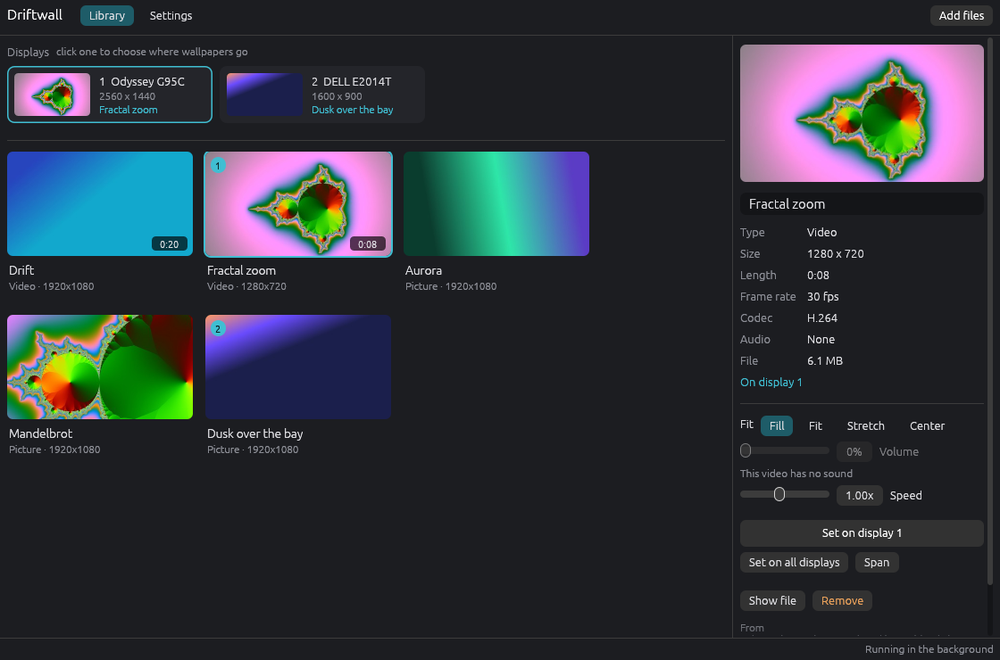

# Driftwall

Live wallpapers for Windows 10 and 11. Put a video or a picture behind your desktop icons, on
one display, on all of them, or stretched across them.



It is a small native program (Rust, one 14 MB exe, no browser engine, no runtime to install) built
to cost as little as possible while it runs:

- **Videos are decoded on the GPU** by Windows' own Media Foundation and scaled by the GPU's video
  processor straight into the wallpaper. The render thread wakes once per display refresh and only
  presents when the video has a new frame.
- **One decode per video.** The same video on several displays is decoded once and drawn to each.
- **Pauses when nobody can see it:** while windows cover a display completely, while a game or any
  app is full screen, on battery or battery saver, while the PC is locked or the screen is off.
- **Lets go of memory when paused.** After 15 seconds paused, a video's decoder and GPU device are
  shut down completely; it starts again when the desktop shows.
- **Muted videos don't touch audio.** With the volume at 0 the sound track isn't decoded and no
  audio device is opened.
- **Pictures cost nothing.** A still wallpaper is rendered once at each display's exact size and
  handed to Windows as the normal desktop picture; nothing keeps running for it.
- **Runs at low CPU priority**, so games and apps always win.

Measured on a Ryzen 7 3700X (16 threads) with an RTX 3060 Ti:

| | CPU | Other |
| --- | --- | --- |
| 1080p 60 fps H.264 on two displays (2560x1440 and 1600x900) | 0.8% of total (12% of one core) | 9% of the GPU video decoder, 0.3% of its 3D engine, 60 frames/s on each display |
| 720p 30 fps on a 240 Hz display | 4.4% of one core | 30 frames/s, 60 wakes/s instead of 240 |
| Paused | 0.000% over 8 s | |
| Paused 15 s (suspended) | 0.000% | private memory 86 MB -> 48 MB, working set trimmed |

## Install

1. Download `driftwall-vX.Y.Z-windows-x64.zip` (or `-arm64`) from
   [Releases](https://github.com/fsiuhgshiqoih32/driftwall/releases/latest).
2. Unzip it anywhere you like to keep it, for example `%LOCALAPPDATA%\Programs\Driftwall`.
3. Run `driftwall.exe`.

The window manages your library. Closing it leaves a small background process (tray icon) that
keeps wallpapers playing; it starts with Windows unless you turn that off in Settings.

Windows SmartScreen may warn about an unrecognised app because the exe isn't code-signed. Choose
More info, then Run anyway.

## Use

- **Add files** (or drag files and folders onto the window). Files on the same drive as
  `%LOCALAPPDATA%` are added as hard links, so they take no extra space; others are copied.
- Click a display at the top to choose where wallpapers go, then double-click a wallpaper, or
  select it and press **Set on display N**. Right-click for other displays, **Set on all
  displays** and **Span** (one wallpaper across every display).
- With a wallpaper selected: **Fit** (Fill, Fit, Stretch, Center), **Volume** (videos start muted)
  and **Speed** (0.25x to 2x).
- Right-click a display to clear it; Windows' own picture comes back.
- The tray icon pauses and resumes videos, opens the window and quits.

Formats: anything Windows can decode. Videos: MP4, M4V, MOV, MKV, WebM, WMV, AVI (H.264 always;
HEVC, VP9 and AV1 with Microsoft's free extensions from the Store). Pictures: JPG, PNG, BMP, GIF
(first frame), WebP, TIFF, HEIC/AVIF (with their extensions), JXR. Camera rotation is applied.

## Settings

| Setting | Default |
| --- | --- |
| Pause a display's video while windows cover it completely | on |
| When an app or game is full screen | pause every display |
| Pause on battery power / while battery saver is on | on / on |
| Start with Windows | on |
| Use each video's first frame as the Windows desktop picture | on |
| Run at low CPU priority | on |

The still frame means the desktop already looks right while Windows starts and after Driftwall
quits, and lets a paused video be shut down and restarted without a visible jump.

## Uninstall

Run `driftwall.exe --reset` (clears every wallpaper, puts Windows' own pictures back, turns off
start with Windows and stops the background process), then delete the exe and
`%LOCALAPPDATA%\Driftwall`.

## Troubleshooting

- **A video won't add:** Windows has no decoder for it. Install the HEVC, VP9 or AV1 extension from
  the Microsoft Store, or convert it to H.264 MP4.
- **Windows N:** videos need the Media Feature Pack (Settings > Apps > Optional features).
- **Several displays but pictures are set as one combined image:** Windows couldn't name the
  displays individually (a monitor whose driver shows an error in Device Manager has no device
  path). Driftwall then draws every display's picture into one desktop-sized image in span mode.
  Videos are unaffected.
- The log is at `%LOCALAPPDATA%\Driftwall\driftwall.log` (Settings > Open log).

## How it works

Explorer draws the desktop picture in a `WorkerW` window behind the icon layer. Driftwall finds it
(on Windows 11 24H2 and later it is a child of `Progman`, below `SHELLDLL_DefView`; on earlier
builds a top-level window behind the icons) and creates one child window per display inside it,
owned by a thread that does nothing but pump messages, so Driftwall can never stall Explorer.

Each video gets a Media Foundation Media Engine in frame-server mode on the GPU that drives the
display. Frames go decoder -> `TransferVideoFrame` (GPU scale and colour conversion) -> a
flip-model swap chain per display. Everything is rebuilt automatically when Explorer restarts,
displays change, or the GPU is reset.

The window (egui) and the background process are the same exe: `driftwall.exe` opens the window,
`driftwall.exe --background` is the background process. They share `library.json` and
`settings.json` in `%LOCALAPPDATA%\Driftwall` and talk through window messages.

Command line: `--background`, `--toggle-pause` (handy for a hotkey), `--reload`, `--quit`,
`--reset`, `--self-test`, `--version`.

## Build

Rust 1.89 or newer with the MSVC toolchain.

```bash
cargo build --release
```

```bash
cargo test
```

`cargo run --example probe_displays` prints what Windows reports about displays and the desktop
window without changing anything. `DRIFTWALL_SHOTS=<folder> cargo test --test ui_shots -- --ignored`
renders the window to PNG files off screen.

Releases are published by CI when the version in `Cargo.toml` changes on `main`.

## License

MIT
